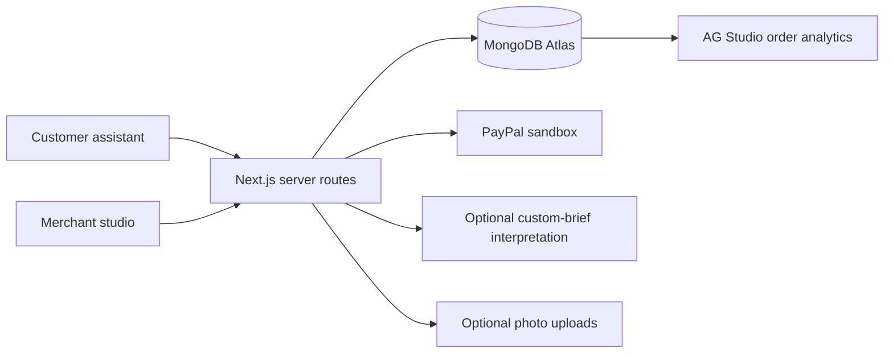

# Crumb

**From conversation to celebration.**

A guided bakery ordering platform that turns incomplete customer requests into reviewed specifications, approved quotes, and payment-verified orders.

[Getting started](#quick-start-windows-powershell) · [MongoDB setup](#mongodb-atlas) · [Judge walkthrough](#judge-walkthrough) · [Deployment](#vercel-deployment) · [License](LICENSE)

## The problem

Custom bakery orders often arrive across messages with missing dates, unclear specifications, and separate payment confirmations. Staff must repeatedly ask for details and reconcile what was requested, approved, and paid.

## The solution

Crumb combines a guided customer assistant with a merchant operations studio. Routine choices use deterministic controls. AI is called only when a customer explicitly requests help interpreting a custom design. The bakery approves the specification and quote before checkout; only verified payments unlock production.

### Customer experience

- Browse 102 reference products across seven categories, with product images and portion details.
- Order through fixed choices with an in-chat product photo, Back, and Exit.
- Submit custom design briefs, ingredient concerns, and pickup preferences for staff review.
- Review the accepted quote, complete PayPal sandbox checkout, and track the order using a secure key.
- Request changes or cancellation without silently modifying an accepted order.

### Merchant experience

- Approve, clarify, or decline order requests with a linked specification and payment history.
- Configure menu availability, stock, lead times, and pickup capacity.
- Move paid orders through preparation, pickup readiness, and collection.
- Review cancellation/refund requests and inspect an audit trail.
- Explore order data through AG Studio and save dashboard layouts to MongoDB.

## Technology

| Layer | Technology |
| --- | --- |
| Application | Next.js 16, React 19, JavaScript |
| Persistence | MongoDB Atlas, MongoDB Node.js driver |
| Payments | PayPal Orders and Payments APIs via APIMatic-generated PayPal Server SDK, sandbox only |
| Optional AI | OpenAI Responses API with bounded structured output |
| Analytics | AG Studio |
| Media | Bundled static assets; optional Cloudinary uploads |
| Deployment | GitHub and Vercel |
| Validation | Node.js test runner and TypeScript JSX parser |

## Architecture



This is a **single-bakery hackathon MVP**. It is independent of Layers. The project owner supplied the menu; PKR reference prices and weights are not independently verified. Generated photography is representative, not exact Layers product photography. The images were generated specifically for this project.

## Quick start (Windows PowerShell)

Requires Node.js 22.15+ (Node 24 recommended), npm, and a MongoDB Atlas database.

```powershell
cd 'C:\paypal ai'
npm ci
# First setup only; do not overwrite an existing .env.local.
if (-not (Test-Path .env.local)) { Copy-Item .env.example .env.local }
```

Edit `.env.local` with your own values. Next.js also supports `.env`; choose one location to avoid conflicting settings. Never commit either file.

Required for durable ordering:

| Variable | Value |
| --- | --- |
| `MONGODB_URI` | Atlas driver connection URI, including database username and URL-encoded password |
| `MONGODB_DB` | `crumb` or your database name |
| `SESSION_SECRET` | Random secret, at least 32 characters |
| `ADMIN_EMAIL` | Bakery owner login email |
| `ADMIN_PASSWORD` | Strong password, at least 12 characters |
| `APP_URL` | `http://localhost:3000` locally; exact HTTPS deployment URL on Vercel |

Generate a session secret:

```powershell
node -e "console.log(require('crypto').randomBytes(48).toString('base64url'))"
```

Then:

```powershell
npm run seed
npm run dev
```

Open **http://localhost:3000**. The seed command creates indexes; the application also ensures essential indexes on first database connection. Initial product records are read from `data/menu.json`, with merchant edits stored as MongoDB overrides.

### Build and production run

```powershell
npm run build
npm start
```

Development and production builds explicitly use Webpack. This avoids Windows environments where Turbopack cannot create a required filesystem junction for server dependencies. The external commands remain `npm run dev` and `npm run build`.

Tests:

```powershell
npm test
```

The repository includes `package-lock.json`. Use `npm ci` for reproducible installations; use `npm install` when intentionally changing dependencies and commit the updated lockfile.

## MongoDB Atlas

1. Create a free Atlas cluster and database user with read/write permission **only for the Crumb database**.
2. Configure Atlas Network Access so your development machine and deployment can connect. Vercel outbound addresses vary by plan; choose an Atlas networking setup suitable for your deployment. Keep database authentication mandatory.
3. Copy the **Drivers / Node.js** URI into `MONGODB_URI`. Encode special characters in the password.
4. Run `npm run seed` to check connectivity and create indexes.

Collections: `orders`, `products`, `settings`, `audit`, `limits`, `locks`, `webhooks`, `aiCache`, `reports`.

Orders, price overrides, stock, capacity settings, customer requests, payment state, and dashboard layouts persist in Atlas. Customer draft selections stay in localStorage on their device until submission. Secure order keys are shown after submission and stored in that browser; losing the key requires bakery assistance. The server stores only its hash.

Judge orders have an expiry of seven days. MongoDB TTL cleanup is asynchronous. Rate-limit buckets and short-lived operation locks also use TTL indexes.

For local exploration without Atlas only, remove the placeholder `MONGODB_URI` and set `ALLOW_MEMORY_DB=true`. This explicit fallback is **disabled in production**, loses data on restart, and is not suitable for deployed evaluation.

### Troubleshooting `querySrv ECONNREFUSED`

This error occurs during DNS SRV discovery, before MongoDB authenticates the database user. Adding `/crumb` to the URI cannot fix a refused DNS query.

Run:

```powershell
npm run db:check
```

The diagnostic displays only the cluster hostname, database name, DNS configuration, and connection result. It does not print the URI, username, or password.

For networks whose default DNS resolver rejects SRV lookups, set:

```dotenv
MONGODB_DNS_SERVERS=1.1.1.1,8.8.8.8
```

This affects the application's Node.js process only; it does not change Windows DNS settings. Leave it blank when system DNS works. Restart the development server after changing it.

If this Atlas URI already works in another project on the same machine, keep the URI unchanged and start with `MONGODB_DNS_SERVERS=`. A forced public DNS resolver may be blocked even when your network's normal resolver works. The diagnostic compares system DNS with an explicit override when one is configured. The application passes the complete URI directly to `MongoClient`; `MONGODB_DB` only selects the database after connecting.

If native SRV/TXT queries are refused, an explicit HTTPS discovery alternative is available:

```dotenv
MONGODB_DNS_SERVERS=
MONGODB_DNS_TRANSPORT=https
```

This sends public Atlas hostname queries to Google's DNS-over-HTTPS service. Credentials and the stored URI are never sent to that service. Crumb discovers the actual SRV nodes and TXT options, preserves the URI's encoded credentials and explicit options, and constructs a standard seed URI in memory with TLS enabled by default. Node hostname lookups also use HTTPS in this mode. The fallback requires HTTPS access to `dns.google`; it does not bypass Atlas authentication, Atlas Network Access, or MongoDB's TCP port requirements. Leave the variable blank to use native MongoDB discovery. See [Google's HTTPS DNS API](https://developers.google.com/speed/public-dns/docs/doh/json).

If SRV discovery still fails, open **Atlas → Connect → Drivers**, disable **SRV Connection String** if offered, and copy the exact standard `mongodb://` URI into `MONGODB_URI`. Preserve Atlas's TLS, replica-set and authentication options. Do not guess shard hostnames or simply replace `mongodb+srv://` with `mongodb://`.

If DNS succeeds but connection fails, confirm the cluster is active, your current IP is in Atlas Network Access, and outbound TCP connections to the Atlas node ports are permitted. See [MongoDB's connection troubleshooting guide](https://www.mongodb.com/docs/atlas/troubleshoot-connection/).

After resolving connectivity:

```powershell
npm run db:check
npm run seed
npm run dev
```

## PayPal sandbox

Add:

```dotenv
PAYPAL_CLIENT_ID=your-sandbox-app-client-id
PAYPAL_CLIENT_SECRET=your-sandbox-app-secret
PAYPAL_WEBHOOK_ID=your-webhook-id
SANDBOX_UNIT_PRICE_USD=12.00
```

Create the app under a PayPal **sandbox business** account and use a **sandbox personal buyer** for checkout. The owner approves each order and sets its separate USD sandbox quote. `SANDBOX_UNIT_PRICE_USD` supplies the server default when an amount isn't specified; the studio quote field is explicit.

The PKR reference catalog is **not converted automatically**. Checkout uses the accepted USD test quote and test funds. This repository deliberately cannot switch to live PayPal by changing an environment flag. Live regional support, merchant onboarding, supported currency, commercial terms and operational policies require a separate launch review.

Configure the webhook URL:

```text
https://YOUR-VERCEL-DOMAIN/api/paypal/webhook
```

Subscribe to `PAYMENT.CAPTURE.COMPLETED`. The handler verifies signatures with PayPal, deduplicates processed events, and reconciles the original order via PayPal's server API. The buyer return page also verifies/captures the payment, so an absent webhook does not cause the browser to label an unverified approval as paid.

Only the application-approved amount is sent. Checkout, capture and full-refund writes use stable PayPal request IDs; retries check existing state. A completed capture must match order identity, amount and currency. Unpaid orders cannot enter production. A pending checkout must be verified before cancellation is resolved.

Return-page and webhook checks share an in-flight reconciliation for the same order. After a capture attempt, Crumb retrieves the complete PayPal order rather than assuming the capture response contains all verification fields. **Verify / recover payment status** can reconcile a completed PayPal order without charging again. Pending payments do not offer a second checkout.

### Dedicated judge sandbox buyer login

Create a disposable **Personal** account in PayPal Developer Dashboard → Testing Tools → Sandbox Accounts. Put only its test email and password in your local environment:

```dotenv
PAYPAL_SANDBOX_BUYER_EMAIL=dedicated-personal-sandbox-email
PAYPAL_SANDBOX_BUYER_PASSWORD=dedicated-personal-sandbox-password
SHOW_SANDBOX_BUYER_CREDENTIALS=true
```

With `DEMO_ENABLED=true`, this explicitly displays the test credentials in the checkout instructions. These credentials are public to demo visitors. Never put a real PayPal/developer login, business-account password or API secret in these fields. The fields are blank and display is off by default. Set the same environment variables on Vercel if the hosted judge demo should show them.

To refund: customer requests cancellation → owner reviews the request → owner explicitly confirms a full sandbox refund. A pending refund is not labelled completed; use Recheck refund status. Refunds outside this app should be reconciled manually; this MVP does not process every possible external dispute/refund lifecycle event.

## Low-token AI

```dotenv
OPENAI_API_KEY=your-key
OPENAI_MODEL=gpt-5.6-luna
AI_DAILY_REQUEST_LIMIT=100
```

Menu choices, greetings, dates, prices, FAQs, Back, Exit, validation, and checkout use **no AI calls**. Only the explicit **Interpret with AI** button calls OpenAI. The request contains at most 2,000 characters, uses no chat history or tools, sets reasoning to `none`, limits output to 350 tokens, disables SDK retries, requests structured JSON, caches repeated inputs, and enforces daily request limits.

If your account does not support the configured model, change the model or use **Use description without AI**. AI never approves a custom design, sets a price, grants allergy assurance, or initiates payment. Relevant request text is sent to OpenAI; avoid sensitive details. No credentials or full customer database are sent.

Model defaults and supported parameters should be checked against your API account. Documentation: https://developers.openai.com/api/docs/models/gpt-5.6-luna

## Photos: GitHub, Vercel, and Cloudinary

**Yes: repository photos deploy with the application.** `public/images/bakery.jpg` is versioned in GitHub, included by Vercel, and served at `/images/bakery.jpg`. Re-deploying does not lose it. The favicon/logo is `public/icon.svg`.

The bundled photo sheet contains twelve original AI-generated subjects, reused as representative images across 102 menu items. These are not 102 unique exact-product photos. No third-party product photographs are bundled.

Cloudinary is needed only for **new merchant uploads after deployment**, because Vercel's function filesystem is not persistent storage. Optional environment values:

```dotenv
CLOUDINARY_CLOUD_NAME=...
CLOUDINARY_API_KEY=...
CLOUDINARY_API_SECRET=...
```

In Merchant studio → Menu → Edit, upload a JPEG, PNG or WebP up to 5 MB. The authenticated server uploads to Cloudinary; the returned URL is saved to the product record in Atlas when you press Save product. API secrets never reach the client. Judge demo uploads are disabled. You can also enter a Cloudinary image URL directly.

## Merchant operations

Open `/studio` and sign in using `ADMIN_EMAIL` / `ADMIN_PASSWORD`.

- **Overview / Orders:** review requests; approve a specific USD sandbox quote; ask clarification; decline.
- **Production:** only paid, accepted orders can move to Preparing → Ready → Collected.
- **Menu:** edit the 102 products, price references, per-outlet/date stock, availability, descriptions and photos.
- **Capacity:** configure slot capacity and lead times. Approval rechecks stock and capacity under a database-backed workspace lock.
- **Assistant:** enable or pause optional AI.
- **Payments:** inspect verified, pending and refunded records.
- **AG Studio:** preconfigured order grid and fulfillment-volume chart; edit and save dashboard layouts to MongoDB.
- **Activity:** load the audit trail.

Only the owner role is implemented for the real bakery. The design's future granular staff roles and multi-merchant signup are not represented as functioning features. Order changes are reviewed through notes; a revised product/price specification requires a replacement request rather than silently changing an approved paid order. This MVP reserves accepted unpaid orders until explicitly cancelled/declined; there is no unattended reservation-expiry job.

## AG Studio and APIMatic

Set `NEXT_PUBLIC_AG_STUDIO_LICENSE_KEY` to your AG Studio trial/commercial key before hosted use. AG Studio is a commercial dependency with its own licensing conditions. It is a real component, not a screenshot. The browser bundle includes the public AG Studio license, which is normal; it must not contain server credentials.

### APIMatic PayPal integration

Crumb uses the official APIMatic-generated `@paypal/paypal-server-sdk` **2.5.0**, pinned in the dependency and lockfile. The SDK transport is the default for creating, retrieving and capturing orders and for issuing/retrieving refunds. `lib/paypal-apimatic.js` preserves wire JSON and decimal amount strings for the existing verified-capture checks, retains stable idempotency keys, disables automatic retries and redacts SDK errors. Webhook signature verification remains on PayPal's Notifications REST endpoint.

APIMatic's **PayPal Context Plugin 0.4.1** was installed in Codex and consulted during the integration review. Its current TypeScript guide describes a different generated client, so official SDK signatures were checked against installed source rather than copied between packages. The plugin is a development tool; the generated SDK is the runtime dependency.

```powershell
npm ci
# Optional: install the development Context Plugin in Codex on another machine.
npm run setup:apimatic-context
npm test
npm run build
# Uses .env.local; creates/reads one unapproved sandbox checkout, never pays.
npm run paypal:check
```

Set `PAYPAL_TRANSPORT=apimatic` in `.env.local` and Vercel, retain the existing PayPal sandbox keys and redeploy. No APIMatic API key is required. `PAYPAL_TRANSPORT=rest` is an explicit rollback option, not a silent fallback. The SDK is declared as a server external package with a traceable import so Vercel includes it in the server function.

Validation on November 12, 2026: 15 tests passed, the production build passed, and live sandbox authentication plus checkout creation/readback passed. The test checkout remained unapproved and no funds moved. Capture, recovery and refund workflows passed with the real SDK against mocked HTTP responses. Real buyer approval, capture, refund and webhook delivery remain hosted-deployment checks. See [integration details](APIMATIC_INTEGRATION.md) and [Devpost text updates](SUBMISSION_UPDATES.md).

## Judge walkthrough

1. Open `/demo`, click **Start isolated judge demo**.
2. Choose **Standard order**. Save its secure key.
3. Click **Review as merchant**, approve the quote.
4. Return to the customer order; accept the specification, policy and USD quote.
5. Complete actual PayPal **sandbox** approval using a sandbox buyer.
6. Return to Crumb; the server verifies capture. Start preparation in the studio.
7. Mark ready and collected; inspect the audit trail and AG Studio.

For no-payment evaluation, choose **Paid production / refund**. It creates an explicitly labelled **synthetic** payment in the isolated demo workspace. It is never counted as verified real sandbox revenue. Judge cookies cannot read the production bakery workspace.

Also test: custom request → optional AI or manual brief; ingredient concern → staff gate; unpaid accepted order → production blocked; Back / Exit retaining selection; failed or cancelled PayPal approval → no paid status; cancellation → owner-confirmed refund.

On the customer order page, **Switch to Merchant Studio** appears below the secure order key when `DEMO_ENABLED=true`. It opens that order's review page in a new tab without requiring the bakery owner's password. The secure order key authorizes a session limited to this single order; it cannot list other bakery orders or change menu/settings. After approving, return to the original customer tab and refresh its status to continue checkout. Set `DEMO_ENABLED=false` to disable this evaluation handoff.

Email/SMS notifications are **not configured or simulated as sent**. Tracking works via the saved key; bakery contact details are available in the order record. Customer and merchant views refresh on demand; customer open-order views also poll every 15 seconds.

## Vercel deployment

See [VERCEL_SETUP.md](VERCEL_SETUP.md) for the full variable-by-variable configuration, including the judge buyer login and webhook setup.

1. Push this repository to your GitHub repository. Do not commit `.env` or `.env.local`.
2. Import it into Vercel. Select **Next.js**, repository root `.`.
3. Install: `npm ci`. Build: `npm run build`. Use the framework's default output directory.
4. Add environment variables in Vercel Project Settings. Set `APP_URL` to your production HTTPS URL. Keep `ALLOW_MEMORY_DB=false`.
5. Deploy, then configure the PayPal sandbox webhook with the deployed URL.
6. Test an actual sandbox transaction end to end. Confirm Atlas access and AG Studio trial validity through the judging period.

Cloudinary and Atlas data survive Vercel deployments because they live outside the function filesystem. Bundled repository photos ship with each deployment. Customer runtime uploads must not be written to `public/` on Vercel.

No GitHub push or external deployment was performed as part of writing this codebase.

## Source layout

```text
app/                       Next.js routes and dark-mode styles
  [[...slug]]/page.js       Customer, order, judge and studio pages
  api/[...path]/route.js    Validated server API handlers
components/                Interactive React UI, Photo, real AG Studio analytics
lib/                       MongoDB, auth, domain rules, PayPal, order services
data/menu.json             All 102 supplied catalog records
public/images/bakery.jpg    Versioned generated photography
public/icon.svg            Crumb mark and browser icon
lib/cli/seed.js            Atlas indexes / connectivity setup
lib/cli/db-check.js        Credential-safe DNS and Atlas connection diagnostic
tests/                     Domain and integration tests with fake transport
```

## Validation

```powershell
npm test
npm run build
```

Tests cover catalog integrity, capture matching, authorization, paid-only production, capacity, ingredient-review gating, idempotent checkout/capture, cancellation/refund, chatbot navigation, and credential-safe MongoDB diagnostics. Service tests use an in-memory adapter and mocked payment transport. UI tests use a component harness; neither replaces browser or real-provider testing.

Latest local validation: **10 tests passed** and **the production Webpack build passed**. Atlas DNS resolution remained blocked in the authoring environment; an authenticated Atlas connection has not been verified there.

Atlas connectivity and real PayPal, OpenAI, Cloudinary, and hosted AG Studio behavior require the owner's credentials/license and end-to-end verification. A DNS-blocked environment cannot establish that Atlas is reachable.

## Contribution and repository hygiene

Keep application source, `package-lock.json`, tests, this README, menu data and bundled assets versioned. The local `docs/` and `scripts/` directories are excluded at the project owner’s request. CLI implementations are retained under `lib/cli/` so the documented npm commands work in fresh clones. `.gitignore` excludes credentials, dependencies, generated builds, logs, editor files and local design generators. `.vercelignore` additionally excludes development-only tests and documentation from deployment uploads.

Before opening a pull request, run the tests and production build. Describe the user-visible behavior and validation performed. Never include `.env.local`, database credentials, payment secrets or customer data in commits.

## License

Application source is available under the [MIT License](LICENSE). Third-party dependencies retain their own licenses. AG Studio requires its own evaluation or commercial license. No rights to third-party trademarks are conveyed.
